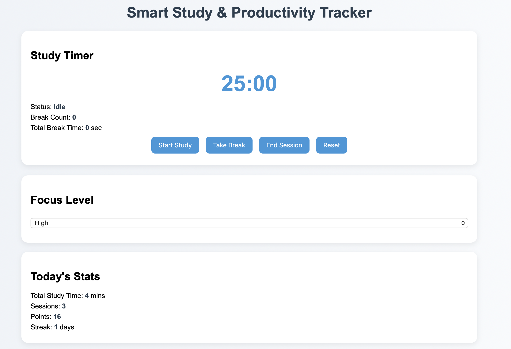
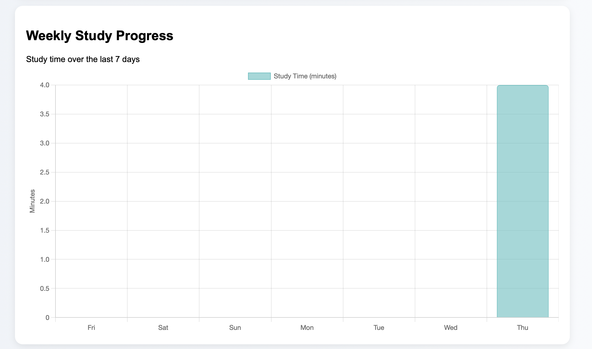
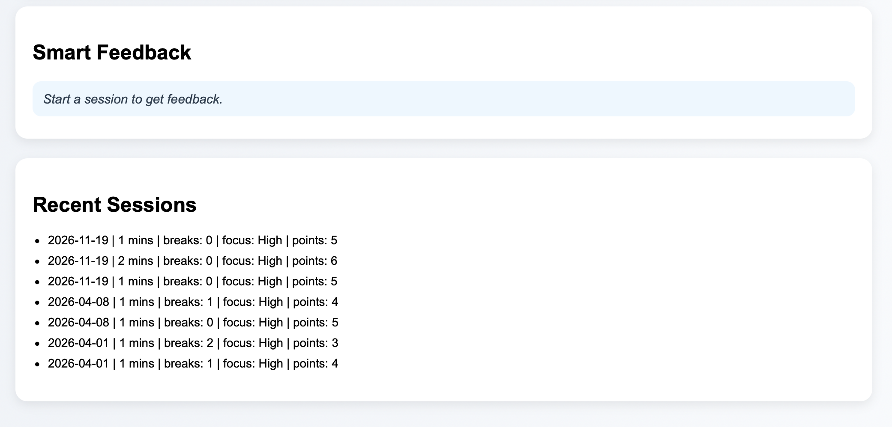

# Smart Study & Productivity Tracker

A web-based productivity application built with Python and Flask that helps students track study sessions, monitor focus levels, and visualize their study progress.

## Features

- **Study Timer:** Track study sessions and breaks.
- **Focus Tracking:** Record high, medium, or low focus levels.
- **Productivity Points:** Earn points based on study duration, focus, and breaks.
- **Smart Feedback:** Receive personalized rule-based feedback after each session.
- **Daily Dashboard:** View total study time, sessions, points, and study streaks.
- **Weekly Analytics:** Visualize study time over the past seven days using an interactive bar chart.
- **Session History:** Review recent study sessions.
- **Automated Tests:** Unit tests for productivity scoring and feedback.

## Screenshots

### Dashboard


### Weekly Chart


### Session History


## Technologies Used

- **Backend:** Python, Flask
- **Frontend:** HTML, CSS, JavaScript
- **Database:** SQLite
- **Data Visualization:** Chart.js
- **Testing:** Python unittest
- **Version Control:** Git and GitHub

## Installation

1. Clone the repository:

   ```bash
   git clone https://github.com/diljot20/Smart-Study-Tracker.git
   ```

2. Navigate into the project folder.

3. Create a virtual environment:

   ```bash
   python3 -m venv .venv
   ```

4. Activate it on macOS/Linux:

   ```bash
   source .venv/bin/activate
   ```

5. Install dependencies:

   ```bash
   python3 -m pip install -r requirements.txt
   ```

6. Run the application:

   ```bash
   python3 app.py
   ```

7. Open http://127.0.0.1:5001 in your browser.

## Running Tests

```bash
python3 -m unittest test_app.py -v
```

## Future Improvements

- User accounts and authentication
- Customizable study goals
- Monthly productivity reports
- Data export functionality

